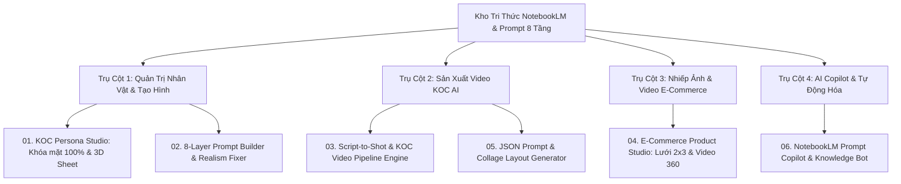

# BẢN ĐỒ TỔNG QUAN HỆ SINH THÁI ỨNG DỤNG AI KOC & E-COMMERCE

> Tài liệu này tổng hợp danh mục toàn bộ các kế hoạch ứng dụng được phân tích chuyên sâu, dựa trên kho tri thức kỹ thuật từ Google Flow, NotebookLM, Prompt 8 tầng và mô hình Video AI (Veo 3.1 & Omni Flash).

---

## 🗺️ Bản Đồ Hệ Sinh Thái Ứng Dụng (Ecosystem Roadmap)

Hệ sinh thái được chia thành 4 trụ cột chiến lược bao phủ toàn bộ vòng đời sáng tạo nội dung số từ **Tạo nhân vật** ➔ **Thiết kế Prompt** ➔ **Sản xuất Video KOC** ➔ **Nhiếp ảnh E-commerce** ➔ **Tự động hóa tri thức**:

---

## 📂 Danh Mục Các File Kế Hoạch Chi Tiết

| Mã File | Tên Kế Hoạch Ứng Dụng | Trọng Tâm Chuyên Sâu | File Chi Tiết |
| :---: | :--- | :--- | :---: |
| **01** | **KOC Persona Studio** | Khóa mặt 100% (Identity Lock), bảng mẫu 3D Turnaround Sheet 15 góc, quản lý hồ sơ nhân vật đa kênh. | [01_KOC_PERSONA_STUDIO.md](file:///Users/kawa/Downloads/drive-download-20261025T092134Z-1-001/ke_hoach_ung_dung/01_KOC_PERSONA_STUDIO.md) |
| **02** | **8-Layer Prompt Builder & Realism Fixer** | Form tạo prompt 8 tầng chuẩn nhiếp ảnh điện ảnh 8K, bộ lọc khử "nhựa AI" (lỗ chân lông, butterfly light, catchlights), song ngữ Anh - Việt. | [02_8LAYER_PROMPT_BUILDER.md](file:///Users/kawa/Downloads/drive-download-20261025T092134Z-1-001/ke_hoach_ung_dung/02_8LAYER_PROMPT_BUILDER.md) |
| **03** | **Script-to-Shot & KOC Video Pipeline Engine** | Tự động hóa từ ý tưởng đến video hoàn chỉnh: chia timeline 3-5 shot, áp dụng 3 quy tắc vàng (Frozen background, Facial movement only, Static camera), đồng bộ khẩu hình Lip-sync. | [03_SCRIPT_TO_SHOT_VIDEO_ENGINE.md](file:///Users/kawa/Downloads/drive-download-20261025T092134Z-1-001/ke_hoach_ung_dung/03_SCRIPT_TO_SHOT_VIDEO_ENGINE.md) |
| **04** | **E-Commerce Product Studio** | System Prompt 2 bước tạo lưới ảnh sản phẩm 2x3, các node tách ảnh tự động 6 góc thương mại, video review 360° bảo toàn form và màu sắc. | [04_ECOMMERCE_PRODUCT_STUDIO.md](file:///Users/kawa/Downloads/drive-download-20261025T092134Z-1-001/ke_hoach_ung_dung/04_ECOMMERCE_PRODUCT_STUDIO.md) |
| **05** | **JSON Prompt & Collage Layout Generator** | Trình sinh cấu trúc JSON prompt đa ngách, layout 3x3 Idol photobook, 4-photo street style collage, triptych tạp chí cao cấp. | [05_JSON_PROMPT_COLLAGE_GENERATOR.md](file:///Users/kawa/Downloads/drive-download-20261025T092134Z-1-001/ke_hoach_ung_dung/05_JSON_PROMPT_COLLAGE_GENERATOR.md) |
| **06** | **NotebookLM Prompt Copilot & Knowledge Bot** | Trợ lý MCP thông minh kết nối trực tiếp với kho tri thức NotebookLM, tư vấn prompt real-time, tự động chuyển đổi file JSON workflow thành Markdown. | [06_NOTEBOOKLM_PROMPT_COPILOT.md](file:///Users/kawa/Downloads/drive-download-20261025T092134Z-1-001/ke_hoach_ung_dung/06_NOTEBOOKLM_PROMPT_COPILOT.md) |

---

## 🎯 Thứ Tự Ưu Tiên Triển Khai (Go-To-Market Strategy)

1. **Giai đoạn 1 (Quick Win - 2 đến 3 tuần):** 
   - Xây dựng **02. 8-Layer Prompt Builder** và **05. JSON Prompt Generator** (Dưới dạng Web App nhẹ hoặc Custom Tool trên Google Flow để kiểm chứng thị trường).
2. **Giai đoạn 2 (Core Value - 1 tháng):**
   - Hoàn thiện **01. KOC Persona Studio** và **04. E-Commerce Product Studio** (Phục vụ trực tiếp cho các nhà bán hàng TikTok Shop, Shopee và Agency).
3. **Giai đoạn 3 (High-End Automation - 2 tháng):**
   - Đóng gói **03. Script-to-Shot & KOC Video Pipeline Engine** kết hợp với **06. NotebookLM Prompt Copilot** thành nền tảng SaaS hoàn chỉnh.
`