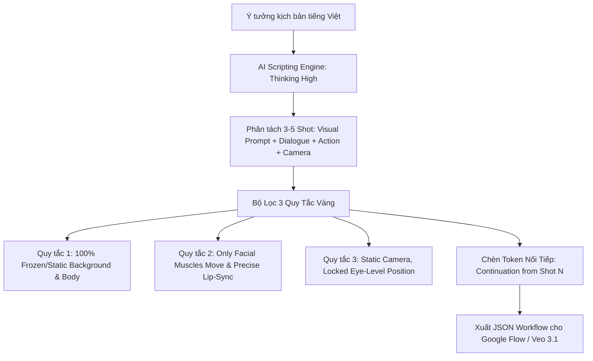

# KẾ HOẠCH CHI TIẾT: SCRIPT-TO-SHOT & KOC VIDEO PIPELINE ENGINE
## Nền Tảng Tự Động Hóa Kịch Bản Phân Cảnh & Sản Xuất Video KOC AI (Veo 3.1 & Omni Flash)

---

## 1. TỔNG QUAN & ĐỊNH VỊ SẢN PHẨM

* **Tên ứng dụng:** **AI Script-to-Shot & KOC Video Pipeline Engine**
* **Slogan:** *"Từ 1 ý tưởng thô đến video KOC triệu view chỉ trong 3 phút"*
* **Định vị:** Bộ công cụ tích hợp giúp tự động chuyển đổi một chủ đề hoặc câu chuyện thành kịch bản phân cảnh điện ảnh (Shot-by-Shot Timeline), tự động áp dụng các quy chuẩn chống méo hình (Background Morphing) và kết nối trực tiếp với pipeline sinh video AI (Google Flow, Veo 3.1, Omni Flash).

---

## 2. NỖI ĐAU THỊ TRƯỜNG & VẤN ĐỀ CẦN GIẢI QUYẾT

1. **Lỗi méo bối cảnh và đổi quần áo khi làm video AI (Morphing Error):** Khi sang shot 2 hoặc shot 3, AI thường tự động thay đổi hoa văn trên áo, đổi màu tóc hoặc biến dạng background phía sau khiến video không thể ghép nối mạch lạc.
2. **Khẩu hình không khớp lời thoại (Lip-sync Mismatch):** Rất khó để yêu cầu AI vừa diễn xuất cơ mặt vừa nhép miệng đúng từng câu nói tiếng Việt một cách tự nhiên.
3. **Kịch bản thiếu tính hành động (Actionless Prompts):** Đa số người làm video chỉ viết lời thoại mà quên mất chỉ thị chuyển động máy quay (Camera Motion) và phản ứng cử chỉ (Action) của nhân vật trong từng giây.

---

## 3. CƠ CHẾ KỸ THUẬT & 3 QUY TẮC VÀNG TỪ GOOGLE FLOW

Hệ thống bắt buộc nhúng **3 Quy Tắc Vàng Kỹ Thuật** vào mọi Shot của video:

### 3.1. Cấu Trúc Chi Tiết Của Một Shot Tiêu Chuẩn
Mỗi shot trong kịch bản được chuẩn hóa thành 4 trường dữ liệu bắt buộc:
* **`Visual Prompt`:** Mô tả bối cảnh và diện mạo nhân vật (bắt buộc kèm từ khóa: *\"Continuation from Shot X. 100% frozen environment, identical posture and lighting\"*).
* **`Dialogue`:** Câu thoại tiếng Việt ngắn gọn, giàu cảm xúc, có nhịp điệu (thường từ 8 - 15 từ / shot).
* **`Camera Motion`:** Khóa tuyệt đối góc máy: *\"Static selfie position, no movement\"* hoặc *\"Absolute fixed camera, locked eye-level\"*.
* **`Action`:** Mô tả chi tiết chuyển động cơ mặt và ánh mắt: *\"Starts with a distant look, eyes snap sharply to lens at first word. Eyebrows lift in gossip style. Pouts playfully at keyword, ends with a radiant smile\"*.

### 3.2. Mẫu Phân Cảnh KOC Điển Hình (Workflow Tâm Sự / Reaction)
* **Shot 1 (Hook mở đầu - 3s):** Nhìn bâng quơ rồi giật mình nhìn thẳng vào camera, nhướn mày gây tò mò.
* **Shot 2 (Thân bài / Nêu vấn đề - 4s):** Nháy mắt tinh nghịch, bĩu môi hờn dỗi hoặc nghiêng đầu giải thích.
* **Shot 3 (Cao trào / Call to action - 4s):** Cười rạng rỡ khoe răng, nháy mắt bên trái, kêu gọi người xem bình luận ("Không được 10 điểm là dỗi ngang nha!").

---

## 4. TÍNH NĂNG CỐT LÕI (CORE FEATURES)

1. **AI Scriptwriter for KOC:** Nhập chủ đề bất kỳ (Ví dụ: *"Review son dưỡng môi mùa đông"*, *"Tâm sự chuyện người yêu vô tâm"*), AI tự động tạo kịch bản 3 đến 5 shot với văn phong Gen Z tự nhiên, dí dỏm.
2. **Auto Shot-by-Shot Prompt Generator:** Tự động sinh ra các cặp câu lệnh tương ứng: Lời thoại tiếng Việt + Visual Prompt tiếng Anh chi tiết + Action tiếng Anh.
3. **Continuity & Consistency Enforcer:** Đảm bảo 100% các shot đều có chỉ thị kế thừa ("Continuation from Shot N"), kiểm soát không cho AI tự ý thay đổi bối cảnh hay trang phục.
4. **Google Flow Workflow Exporter:** Xuất trực tiếp cấu trúc file JSON gồm đầy đủ Node Character, Node Script, Node Voice và các Edge liên kết để import thẳng vào Google Flow chỉ trong 1 giây.
5. **Timeline Preview & Audio Duration Estimator:** Tính toán thời lượng giọng đọc dự kiến cho từng câu thoại để đồng bộ hoàn hảo với độ dài video render (mỗi shot từ 3s - 5s).

---

## 5. CÔNG NGHỆ & TECH STACK ĐỀ XUẤT

* **Frontend:** React / Vite với Flow Canvas (sử dụng thư viện `React Flow` hoặc `@xyflow/react` giống như Google Flow).
* **AI Engine:** Gemini 1.5 Pro (với cấu hình `thinkingLevel: "high"`) để phân tích ngữ cảnh kịch bản và diễn xuất điện ảnh.
* **Audio Synthesis:** Tích hợp ElevenLabs hoặc Google Text-to-Speech (giọng tiếng Việt tự nhiên) để tự động sinh file WAV làm input cho lip-sync.
* **Video Automation:** API tích hợp Veo 3.1 / Omni Flash / Kling AI qua webhook.

---

## 6. LỘ TRÌNH TRIỂN KHAI (ROADMAP)

* **Giai đoạn 1 (Tuần 1 - 2):** Xây dựng AI Script Generator chuyên tạo kịch bản 3-5 shot theo đúng định dạng 4 trường (Visual, Dialogue, Camera, Action).
* **Giai đoạn 2 (Tuần 3 - 4):** Xây dựng module tự động xuất file JSON tương thích 100% với Google Flow (loại bỏ Base64 rác, chuẩn hóa node).
* **Giai đoạn 3 (Tuần 5 - 6):** Tích hợp trình tạo âm thanh tự động và đồng bộ lip-sync thử nghiệm trên Veo 3.1.

---

## 7. MÔ HÌNH KINH DOANH & THƯƠNG MẠI HÓA

* **Gói Dùng Thử (Free):** Tạo 3 kịch bản video/ngày.
* **Gói Creator Pro ($29/tháng):** Tạo không giới hạn kịch bản, thư viện 50+ mẫu kịch bản triệu view (Tâm sự, Reaction hài hước, Unboxing, Cosplay), xuất file JSON Google Flow 1-click.
* **Gói Agency Automation ($99/tháng):** Tạo hàng loạt (Batch creation) 30 kịch bản video cùng lúc chỉ với 1 bảng tính Google Sheet chứa danh sách sản phẩm.
