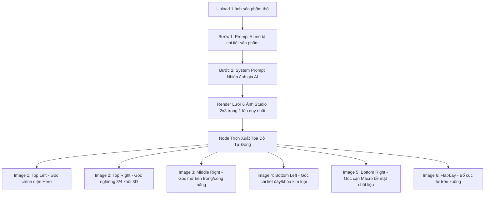

# KẾ HOẠCH CHI TIẾT: E-COMMERCE PRODUCT STUDIO
## Studio Tự Động Chụp Bộ Ảnh Sản Phẩm Lưới 2x3 & Video Review 360° Chuẩn Điện Ảnh 8K

---

## 1. TỔNG QUAN & ĐỊNH VỊ SẢN PHẨM

* **Tên ứng dụng:** **E-Commerce Product Studio**
* **Slogan:** *"Chụp 1 ảnh điện thoại – Nhận trọn bộ ảnh Studio 6 góc và Video Review 360°"*
* **Định vị:** Giải pháp tự động hóa nhiếp ảnh và sản xuất video sản phẩm dành riêng cho người bán hàng trên sàn thương mại điện tử (Shopee, TikTok Shop, Lazada, Amazon). Giúp chủ shop tiết kiệm 90% chi phí thuê studio chụp hình, thuê mẫu và quay dựng phức tạp.

---

## 2. NỖI ĐAU THỊ TRƯỜNG & VẤN ĐỀ CẦN GIẢI QUYẾT

1. **Chi phí chụp ảnh Studio đắt đỏ:** Mỗi lần ra mắt mẫu mới (giày dép, túi xách, mỹ phẩm, thời trang), shop phải tốn từ 2 - 5 triệu VNĐ cho một buổi chụp studio với người mẫu.
2. **Ảnh thiếu góc chụp chi tiết khiến khách ngập ngừng mua:** Khách mua hàng online cần thấy góc chính diện, góc nghiêng 45°, chi tiết đường may/khóa kéo (Macro) và ảnh nhìn từ trên xuống (Top-down).
3. **Sản phẩm bị biến dạng khi làm video AI (Product Morphing):** Khi đưa ảnh sản phẩm vào các tool làm video, logo thường bị mờ, quai dép bị méo, màu sắc bị sai lệch so với sản phẩm thực tế.

---

## 3. CƠ CHẾ KỸ THUẬT CỐT LÕI TỪ TÀI LIỆU KHOA HỌC

Hệ thống hoạt động dựa trên 2 quy trình tự động hóa độc quyền:

### 3.1. Quy Trình System Prompt 2 Bước Tạo Lưới 2x3 & Node Trích Xuất Ảnh

* **Bước 1 (Mô tả chi tiết sản phẩm):**
  `"Describe the product in the image in detail. Provide the description of the product only, no other text is required."`
* **Bước 2 (System Prompt điều khiển Nhiếp ảnh gia AI):**
  `"You are a product photographer, using the attached image and product description go through the following steps to deliver the output. 1. Review the product and description 2. Come up with 6 product shot ideas which could be used on an e-commerce website, showing off the product from different angles on a clean studio background. 3. Take your 6 ideas and provide them in a numbered list. The output should be formatted: Generate a set of 6 images in a 2x3 grid using the details below..."`
* **Nút trích xuất tọa độ tự động (Node Extraction):** Cắt tự động 6 ảnh độc lập chuẩn độ phân giải cao phục vụ đăng tải sàn TMĐT mà không cần thao tác Photoshop thủ công.

### 3.2. Kỹ Thuật Video Review 360° Khóa Form Tuyệt Đối
Tạo video bàn tay nhấc sản phẩm, xoay 360 độ khoe chi tiết và đặt xuống với các ràng buộc bảo toàn:
* **Preservation Prompt:**
  `"Commercial product video. Use reference image as absolute standard. Hand lifts product from wooden floor toward lens decisively. Throughout movement, product must strictly preserve exact shape, proportions, color, seams and buckle details, no distortion or morphing. Hand rotates product slowly 360 degrees horizontally. Always keep product in center and parallel to lens. Camera fixed, no shake. Studio lighting, soft bokeh, 4K sharp focus."`

---

## 4. TÍNH NĂNG CỐT LÕI (CORE FEATURES)

1. **1-Click 2x3 Grid Generator:** Tải lên ảnh chụp thô bằng điện thoại ➔ Hệ thống tự động tách nền, đặt vào bối cảnh Studio chuyên nghiệp và xuất ra lưới 6 góc trong 30 giây.
2. **8 Chế Độ Góc Máy Thương Mại Đỉnh Cao:**
   * **Hero 45° View:** Góc diện mạo chính trên trang sản phẩm.
   * **Top-Down (Flat-Lay):** Bố cục phẳng từ trên xuống.
   * **Macro Detail:** Zoom cận cảnh đường kim mũi chỉ, vân da, khóa kim loại.
   * **Lower-Angle:** Góc chụp từ dưới lên tạo cảm giác bề thế, cao cấp.
   * **Minimal Studio / Surreal Scene / Product Spotlight Studio:** Đặt sản phẩm lên bệ khối hoặc dải sáng spotlight cao cấp.
3. **Auto 360° Spin Video Creator:** Tạo video ngắn 5 - 8 giây xoay sản phẩm 360 độ mượt mà, sẵn sàng làm video mô tả sản phẩm trên TikTok Shop hoặc Shopee Video.
4. **Batch Mode for Catalog:** Xử lý cả bộ sưu tập 20 sản phẩm chỉ trong một lượt tải lên.

---

## 5. CÔNG NGHỆ & TECH STACK ĐỀ XUẤT

* **Frontend:** Next.js với Canvas Crop Tool (hỗ trợ kéo tỉ lệ 1:1 cho Shopee, 3:4 cho sàn TMĐT thời trang, 9:16 cho video TikTok).
* **AI Vision & Upscaling:** Sử dụng Gemini Vision để sinh mô tả sản phẩm; Stable Diffusion / Flux kết hợp ControlNet Canny/Depth để giữ nguyên cấu trúc vật thể; Upscaler Real-ESRGAN để xuất ảnh 8K.
* **Video Generation:** Veo 3.1 / Kling AI để sinh chuyển động xoay 360 độ và nhấc sản phẩm.

---

## 6. LỘ TRÌNH TRIỂN KHAI (ROADMAP)

* **Giai đoạn 1 (Tuần 1 - 2):** Xây dựng module System Prompt 2 bước sinh lưới 2x3 và thuật toán tự động crop 6 hình ảnh đơn lẻ.
* **Giai đoạn 2 (Tuần 3 - 4):** Xây dựng bộ thư viện bối cảnh Studio (Bục đá cẩm thạch, bãi cát nghệ thuật, phòng khách tối giản, ánh sáng Spotlight).
* **Giai đoạn 3 (Tuần 5 - 6):** Tích hợp tính năng tạo video review xoay 360° khóa form sản phẩm.

---

## 7. MÔ HÌNH KINH DOANH & THƯƠNG MẠI HÓA

* **Pay-per-product (Gói lẻ):** 29.000 VNĐ / 1 sản phẩm (Nhận 6 ảnh Studio chất lượng cao + 1 video xoay 360°).
* **Gói Shop Tiêu Chuẩn (299.000 VNĐ/tháng):** 20 sản phẩm / tháng (Tương đương 120 ảnh Studio + 20 video review).
* **Gói Enterprise (Agency & Xưởng sản xuất):** 1.490.000 VNĐ/tháng cho 150 sản phẩm, hỗ trợ API đồng bộ tự động với kho hàng.
