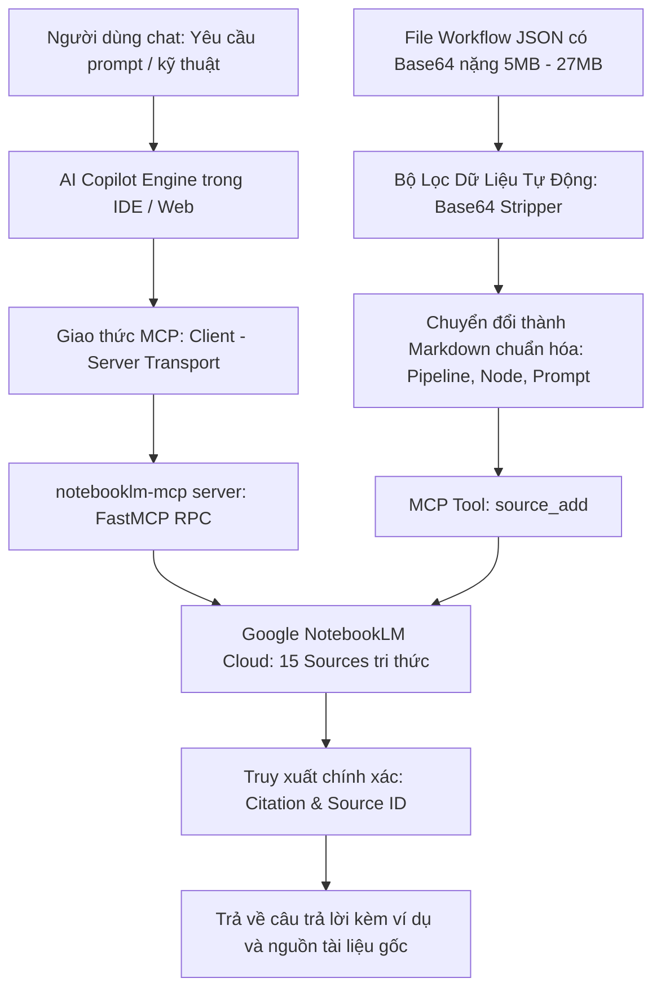

# KẾ HOẠCH CHI TIẾT: NOTEBOOKLM PROMPT COPILOT & KNOWLEDGE AUTOMATION
## Trợ Lý AI Chuyên Sâu Tích Hợp MCP – Tra Cứu Tri Thức & Tự Động Hóa Workflow Sáng Tạo

---

## 1. TỔNG QUAN & ĐỊNH VỊ SẢN PHẨM

* **Tên ứng dụng:** **NotebookLM Prompt Copilot & Knowledge Bot**
* **Slogan:** *"Bộ não trợ lý thứ hai – Nắm trọn mọi kỹ thuật prompt và workflow trong tầm tay"*
* **Định vị:** Trợ lý ảo AI hoạt động dựa trên giao thức Model Context Protocol (MCP), kết nối trực tiếp với kho dữ liệu Google NotebookLM của người dùng. Cho phép tra cứu kỹ thuật prompt có trích dẫn nguồn chính xác 100%, tự động làm sạch và chuyển đổi file đồ thị JSON thành tài liệu tri thức, đồng thời tạo ra các nội dung Studio (Podcast âm thanh, Flashcard, Quiz) hoàn toàn tự động.

---

## 2. NỖI ĐAU THỊ TRƯỜNG & VẤN ĐỀ CẦN GIẢI QUYẾT

1. **Kiến thức bị phân mảnh và trôi mất:** Người dùng tải về hàng chục file PDF, tài liệu hướng dẫn, file video và workflow JSON nhưng mỗi khi cần viết prompt lại không nhớ kỹ thuật đó nằm ở trang nào, file nào.
2. **File JSON workflow quá nặng và rác dữ liệu:** Các file xuất từ Google Flow chứa hàng triệu ký tự Base64 (audio, video, ảnh), nếu đưa trực tiếp vào NotebookLM sẽ làm tràn bộ nhớ (token overflow) và AI không đọc được.
3. **Mất thời gian học thủ công:** Để đào tạo một nhân sự mới làm video KOC mất hàng tuần đọc tài liệu và thử nghiệm sai lỗi liên tục.

---

## 3. CƠ CHẾ KỸ THUẬT & KIẾN TRÚC KẾT NỐI MCP

Hệ thống tận dụng trực tiếp kiến trúc **`notebooklm-mcp-cli`** đã được cấu hình và kiểm chứng thành công:

### 3.1. Các Công Cụ MCP Trọng Tâm Được Khai Thác
* **`notebook_query`:** Gửi câu hỏi chuyên sâu và nhận câu trả lời có trích dẫn tài liệu gốc (như cách đã trích xuất thành công 8 nhóm kỹ thuật vừa qua).
* **`source_add` & `source_sync_drive`:** Tự động đồng bộ các file tài liệu mới nhất từ máy tính hoặc Google Drive vào NotebookLM mà không cần mở trình duyệt.
* **`studio_create`:** Kích hoạt tạo **Audio Overview (Podcast)** đàm thoại giữa 2 chuyên gia AI về kỹ thuật prompt để người dùng nghe học tập khi di chuyển.

### 3.2. Pipeline Làm Sạch JSON Workflow Tự Động
Tích hợp thuật toán từ script `scratch_convert.py` thành một nút bấm giao diện:
1. Đọc file JSON từ Google Flow.
2. Nhận diện các khóa nhị phân (`base64`, `data:image`, `data:audio`, `data:video`).
3. Cắt tỉa và chỉ giữ lại cấu trúc đồ thị logic: Node ID, Node Type, System Prompt, Timeline Shots, Camera Motion.
4. Xuất ra tệp Markdown tinh gọn (từ 27MB giảm xuống còn vài chục KB) và tự động nạp thẳng vào NotebookLM qua MCP.

---

## 4. TÍNH NĂNG CỐT LÕI (CORE FEATURES)

1. **Context-Aware Prompt Assistant:** Trợ lý chat trong IDE hoặc trên web. Người dùng chỉ cần gõ: *"Lấy cho tôi prompt cosplay Nami trong tài liệu"* ➔ Trợ lý truy xuất trực tiếp từ notebook và trả lời đầy đủ thông số bối cảnh nhà sách, góc máy tĩnh và lời thoại.
2. **1-Click JSON-to-Knowledge Converter:** Kéo thả bất kỳ file workflow JSON nào vào ứng dụng ➔ Hệ thống tự động phân tích và nạp vào kho tri thức của NotebookLM chỉ sau 3 giây.
3. **Automated Audio Training Generator:** Bấm 1 nút để biến toàn bộ kho tài liệu thành một tập podcast âm thanh sinh động (Audio Overview Deep Dive), phân tích các lỗi sai hay gặp và mẹo làm video.
4. **Interactive Flashcard & Quiz Mode:** Tự động tạo bộ câu hỏi trắc nghiệm và thẻ học tập (Ví dụ: *"3 quy tắc vàng trong Veo 3.1 là gì?"*) phục vụ đào tạo nội bộ agency.

---

## 5. CÔNG NGHỆ & TECH STACK ĐỀ XUẤT

* **Core Interface:** Web Dashboard (Next.js 14) hoặc Desktop Client kết nối qua Local MCP Socket.
* **MCP Backend:** Python với thư viện `fastmcp` và `notebooklm-mcp-cli 0.15.7`.
* **State & Authentication:** Quản lý phiên đăng nhập Google an toàn qua OS Keystore (`nlm auth storage set protected`).
* **Workflow Automation Engine:** Node.js / Python background workers để xử lý chuyển đổi file lớn.

---

## 6. LỘ TRÌNH TRIỂN KHAI (ROADMAP)

* **Giai đoạn 1 (Tuần 1):** Xây dựng giao diện Web Chat đơn giản kết nối trực tiếp với MCP Server `notebooklm-mcp` qua Localhost.
* **Giai đoạn 2 (Tuần 2):** Hoàn thiện công cụ kéo thả tự động chuyển đổi file JSON đồ thị thành Markdown sạch và tự nạp vào Notebook.
* **Giai đoạn 3 (Tuần 3 - 4):** Xây dựng tính năng kích hoạt và tải tự động các sản phẩm Studio (Audio Overview MP3, Flashcard JSON).

---

## 7. MÔ HÌNH KINH DOANH & THƯƠNG MẠI HÓA

* **Sản phẩm Đào Tạo (Info Product):** Bán kèm gói "Kho tri thức KOC AI số hóa" – người mua chỉ cần import vào tài khoản là có ngay một trợ lý AI thông minh biết tuốt mọi quy trình.
* **Internal Agency Tool:** Đóng gói thành phần mềm nội bộ cho các Agency truyền thông, giúp tối ưu hóa hiệu suất làm việc của đội ngũ sáng tạo nội dung lên gấp 5 lần.
* **Bản quyền SaaS ($19 - $49/tháng):** Dịch vụ kết nối và đồng bộ tự động giữa các công cụ sáng tạo (Google Flow, Midjourney) với kho tri thức NotebookLM của doanh nghiệp.
